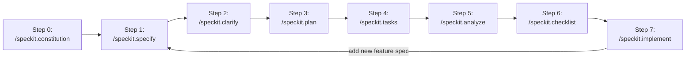

# `AGENTS.md` AI Agent Instruction File for the `mdxpad` codebase

> `mdxpad` is a robust, performant, flexible, extensible, modern markup editor powered by `MDX`.

A native macOS application built with Electron 39, React 19, and TypeScript 5.9 in strict mode. Provides a powerful editing experience for Markdown and MDX files with live preview, AI integration, and extensibility.

---

## Project Architecture

### Process Model
MDXPad follows Electron's multi-process architecture with strict separation:

```
┌─────────────────────────────────────────────────────────┐
│ Main Process (src/main/)                                │
│ - Application lifecycle                                 │
│ - File system operations (file-service.ts)              │
│ - Native OS integration (menu.ts, window.ts)            │
│ - IPC handlers (ipc/)                                   │
│ - Services: AI, templates, autosave, recovery           │
└─────────────────────────────────────────────────────────┘
                        │
                        │ IPC (Zod validated)
                        ▼
┌─────────────────────────────────────────────────────────┐
│ Preload Script (src/preload/)                          │
│ - Context bridge (contextIsolation enabled)            │
│ - Type-safe API exposure via window.api                │
│ - Request/response validation                           │
└─────────────────────────────────────────────────────────┘
                        │
                        ▼
┌─────────────────────────────────────────────────────────┐
│ Renderer Process (src/renderer/)                        │
│ - React 19 application (App.tsx)                        │
│ - CodeMirror 6 editor (components/editor/)              │
│ - MDX preview with worker compilation                   │
│ - Zustand + Immer stores (stores/)                      │
│ - UI components (Radix + Tailwind)                      │
└─────────────────────────────────────────────────────────┘
                        │
                        ▼
┌─────────────────────────────────────────────────────────┐
│ Shared (src/shared/)                                    │
│ - Type definitions (types/)                             │
│ - IPC contracts with Zod schemas (contracts/)           │
│ - Utilities (lib/atomic-write, checksum)                │
│ - Constants and AI config (ai/)                         │
└─────────────────────────────────────────────────────────┘
```

### Directory Structure
```
mdxpad/
├── src/
│   ├── main/              # Main process (Node.js)
│   │   ├── index.ts       # Entry point, app lifecycle
│   │   ├── window.ts      # Window management
│   │   ├── menu.ts        # Native menus
│   │   ├── ipc/           # IPC handlers
│   │   │   ├── file-handlers.ts
│   │   │   ├── ai-handlers.ts
│   │   │   ├── template-handlers.ts
│   │   │   ├── autosave-handlers.ts
│   │   │   └── window-handlers.ts
│   │   └── services/      # Business logic
│   │       ├── file-service.ts
│   │       ├── file-watcher.ts
│   │       ├── recent-files.ts
│   │       ├── autosave-service.ts
│   │       ├── recovery-service.ts
│   │       ├── template-service.ts
│   │       └── ai/        # AI provider abstraction
│   │           ├── ai-service.ts
│   │           ├── provider-service.ts
│   │           ├── capability-service.ts
│   │           ├── credential-service.ts
│   │           ├── usage-service.ts
│   │           └── onboarding-service.ts
│   ├── preload/           # Context bridge
│   │   ├── index.ts       # Main bridge
│   │   └── ai-api.ts      # AI-specific APIs
│   ├── renderer/          # React application
│   │   ├── App.tsx        # Root component
│   │   ├── main.tsx       # React entry
│   │   ├── components/    # UI components
│   │   │   ├── editor/    # CodeMirror integration
│   │   │   ├── preview/   # MDX preview
│   │   │   ├── outline/   # Document outline
│   │   │   ├── command-palette/
│   │   │   ├── template-browser/
│   │   │   └── frontmatter/
│   │   ├── stores/        # Zustand state
│   │   │   ├── document-store.ts
│   │   │   ├── preview-store.ts
│   │   │   ├── template-store.ts
│   │   │   ├── frontmatter-store.ts
│   │   │   ├── autosave-store.ts
│   │   │   └── settings-store.ts
│   │   ├── hooks/         # React hooks
│   │   ├── lib/           # Utilities
│   │   │   └── mdx/       # MDX compilation
│   │   │       └── compiler.ts (worker pool)
│   │   └── workers/       # Web workers
│   └── shared/            # Cross-process code
│       ├── types/         # TypeScript definitions
│       ├── contracts/     # IPC schemas
│       ├── lib/           # Shared utilities
│       │   ├── atomic-write.ts
│       │   └── checksum.ts
│       └── ai/            # AI-related shared code
├── tests/                 # Test files
│   ├── unit/
│   ├── integration/
│   └── e2e/
├── scripts/               # Build and utility scripts
├── .github/workflows/     # CI/CD
└── docs/                  # Documentation
    ├── constitution/      # Architectural principles
    └── specs/             # SDD specifications
```

### Key Patterns

#### IPC Communication
All IPC uses Zod-validated request/response schemas from `src/shared/contracts/`:

```typescript
// src/shared/contracts/file-schemas.ts
import { z } from 'zod';

export const ReadFileRequestSchema = z.object({
  filePath: z.string(),
});

export const ReadFileResponseSchema = z.object({
  content: z.string(),
  // ...
});

// src/main/ipc/file-handlers.ts
ipcMain.handle('file:read', async (_, request) => {
  const validated = ReadFileRequestSchema.parse(request);
  // ...
  return ReadFileResponseSchema.parse(result);
});

// src/preload/index.ts
readFile: (filePath: string) =>
  validatedInvoke('file:read', { filePath }, ReadFileResponseSchema)
```

#### State Management
Zustand with Immer for immutable updates:

```typescript
// src/renderer/stores/document-store.ts
import { create } from 'zustand';
import { immer } from 'zustand/middleware/immer';

interface DocumentState {
  content: string;
  isDirty: boolean;
  setContent: (content: string) => void;
}

export const useDocumentStore = create<DocumentState>()(
  immer((set) => ({
    content: '',
    isDirty: false,
    setContent: (content) =>
      set((state) => {
        state.content = content;
        state.isDirty = true;
      }),
  }))
);
```

#### MDX Compilation
Worker pool pattern for non-blocking compilation:

```typescript
// src/renderer/lib/mdx/compiler.ts
// - Manages pool of Web Workers
// - Request queue with priority
// - Heartbeat monitoring
// - Telemetry for performance tracking
```

#### File Operations
Atomic writes with checksums for data integrity:

```typescript
// src/shared/lib/atomic-write.ts
// - Write to temporary file
// - Compute checksum
// - Atomic rename
// - Cleanup on error
```

#### Error Handling
Custom error classes with context:

```typescript
// src/shared/types/errors.ts
export class FileReadError extends Error {
  constructor(message: string, options?: ErrorOptions) {
    super(message, options);
    this.name = 'FileReadError';
  }
}
```

### Testing Conventions

- **Unit Tests**: Colocate in `__tests__/` directories or `*.test.ts` files
- **Test Naming**: Describe behavior, not implementation
- **AAA Pattern**: Arrange-Act-Assert
- **Coverage Target**: 80%+ overall, 90%+ for critical paths
- **Stores**: Test state transitions and side effects
- **Hooks**: Use `@testing-library/react` `renderHook` and `act`
- **E2E**: Playwright for critical user flows

Example:
```typescript
// src/renderer/stores/__tests__/document-store.test.ts
import { describe, it, expect, beforeEach } from 'vitest';
import { renderHook, act } from '@testing-library/react';
import { useDocumentStore } from '../document-store';

describe('useDocumentStore', () => {
  beforeEach(() => {
    useDocumentStore.getState().reset();
  });

  it('should mark document as dirty when content changes', () => {
    const { result } = renderHook(() => useDocumentStore());

    act(() => {
      result.current.setContent('new content');
    });

    expect(result.current.isDirty).toBe(true);
  });
});
```

### File Organization Rules

- **Max File Size**: 400 lines (enforced via ESLint)
- **Single Responsibility**: One clear purpose per file
- **Barrel Exports**: Use `index.ts` for module exports
- **Naming**:
  - Files: `kebab-case.ts` (e.g., `file-service.ts`)
  - Components: `PascalCase.tsx` (e.g., `EditorPanel.tsx`)
  - Tests: `*.test.ts` or `*.test.tsx`

### Code Quality Standards

- **TypeScript**: Strict mode, no `any`, minimal type casts
- **Linting**: ESLint 9 with typescript-eslint 8, zero errors
- **Formatting**: Prettier 3.4
- **Test Coverage**: 80%+ overall
- **Type Safety**: Avoid `as unknown as`, use type guards
- **Error Handling**: Zod validation for all IPC boundaries

---

## Your Tools
NOTE: this is not an exhaustive list of your tools. make sure to always check for relevant tools as needed/appropriate/useful.

### Search Tools
NOTE: all of these tools are available to you as [MCP (model context protocol)](https://modelcontextprotocol.io/) servers/tools
- [`Tavily Search`](https://docs.tavily.com/documentation/mcp): smart AI context gathering search tool service
- [`Brave Search`](https://github.com/brave/brave-search-mcp-server): easy web search
- `fetch_urls` (from [`fetcher`](https://github.com/jae-jae/fetcher-mcp): robust multi-URL fetcher
- `fetch_html`, `fetch_json`, `fetch_txt`, `fetch_markdown` (from [`fetch`](https://github.com/zcaceres/fetch-mcp)): targeted content fetchers
- [`context7`](https://github.com/upstash/context7):  pulls up-to-date, version-specific documentation and code examples straight from the source — and places them directly into your prompt.
- [`deepwiki`](https://docs.devin.ai/work-with-devin/deepwiki-mcp): provides programmatic access to DeepWiki’s public repository documentation and search capabilities
- [`repomix`](https://repomix.com/guide/mcp-server): provides tools that enable AI assistants to package local or remote repositories for analysis without requiring manual file preparation.

### Thinking/Reasoning Methods
NOTE: THESE MCP SERVERS/TOOLS CAN BE USED INDIVIDUALLY OR COMBINED/ENSEMBLED AS NEEDED/APPROPRIATE/USEFUL TO MOST EFFECTIVELY SOLVE A GIVEN PROBLEM/REQUEST.
- [`sequential-thinking`](https://github.com/modelcontextprotocol/servers/tree/main/src/sequentialthinking): provides a tool for dynamic and reflective problem-solving through a structured thinking process
- [`atom-of-thoughts`](https://github.com/kbsooo/MCP_Atom_of_Thoughts): a decomposition-based reasoning framework.
- [`shannon-thinking`](https://github.com/olaservo/shannon-thinking): helps break down complex problems into structured thoughts following Shannon's approach of problem definition, mathematical modeling, and practical implementation.
- [`structured-thinking`](https://github.com/Promptly-Technologies-LLC/mcp-structured-thinking): motivation for this project is to allow LLMs to programmatically construct mind maps to explore an idea space, with enforced "metacognitive" self-reflection.
- [`crash`](https://github.com/nikkoxgonzales/crash-mcp): structured, iterative reasoning. CRASH helps AI assistants break down complex problems into trackable steps with confidence tracking, revision support, and branching for exploring alternatives.
- [`deep-lucid-3d`](https://github.com/MushroomFleet/DeepLucid3D-MCP): an implementation of the Unified Cognitive Processing Framework as an MCP server. It combines recursive self-awareness with dimensional knowledge categorization to provide a powerful approach to problem-solving and creative thinking.
- [`cascade-thinking`](https://github.com/drewdotpro/cascade-thinking-mcp): Transform linear problem-solving into rich, multi-dimensional exploration with true branching and intelligent thought management.): Transform linear problem-solving into rich, multi-dimensional exploration with true branching and intelligent thought management.
- [`lotus-wisdom`](https://github.com/linxule/lotus-wisdom-mcp):  provides a tool for problem-solving using the Lotus Sutra's wisdom framework, combining analytical thinking with intuitive wisdom.
- [`think-strategies`](https://github.com/aaronsb/think-strategies): provides a tool for dynamic and reflective problem-solving through structured thinking processes.
- [`creative-thinking`](https://github.com/uddhav/creative-thinking): implements 28 creative thinking techniques through a unified framework combining generative creativity with systematic risk assessment, analytical verification, and post-action reflexivity tracking.

---

## Codebase Development Methodology & Framework
- [`Spec-Driven Development` (**`SDD`**)](https://github.com/github/spec-kit/blob/main/spec-driven.md) is the primary development methodology/framework for this codebase.
- [`GitHub Spec Kit`](https://github.com/github/spec-kit/blob/main/README.md) (e.g. *`specify`* *cli*) orchestrates + manages **`SDD`** flows for all non-trivial features/enhancements/bug fixes.

### `spec-kit` dev flow

an AI dev agent uses [e.g. for ***Claude Code***: `.claude/commands/` `spec-kit` commands (e.g. `specify`, `clarify`, `plan`, `tasks`, `analyze`, `checklist`, `implement` etc)] to orchestrate + manage the dev flow for non-trivial features/enhancements/bug fixes in a new branch as per **`SDD`** methodology/framework:



In ***Claude Code***, batches of parallel, intelligently well-defined *subagents* are used to efficiently + robustly implement all of the tasks in the tasks list for each non-trivial feature/enhancement/bug fix. Flows of which are independent from each other enough are developed in parallel by separate claude code instances (each with its own iterative batches of parallel subagents) on different git worktrees/branches, and then merged together later.

---

## Your Rules
YOU MUST FOLLOW ALL OF THE RULES BELOW (7/7 total rules) AT ALL TIMES!!!
- use latest versions: always use the latest stable versions of any and all dependencies/libraries/packages/frameworks. use your `package version` and `context7` MCPs (and any others as useful) for help
- batch operations: always batch your tool calls (operations) where possible: MCP tools (e.g., `fetch_urls` [from the `fetcher` MCP] over repeated `fetch_url`), shell commands via brace expansion (`mkdir dir/{a,b,c}`), and similar parallelizable patterns.
- reuse existing logic: always check for existing logic/code snippets/utilities/libraries/packages that can be reused/extended to satisfy a request before creating new logic/code from scratch.
- web research first when uncertain: whenever uncertainty arises start by conducting deep, targeted web research to gather the latest information from authoritative sources using your MCP web tools (e.g Brave Search, Tavily Search, etc). if this additional web research does not elucidate the uncertainty, then succinctly interview the user to clarify the uncertainty before proceeding.
- maintain freshest info: whenever up-to-date information is useful/helpful/required, always use your MCP web tools (e.g Brave Search, Tavily Search, etc) to gather the latest information from authoritative sources.
- robustly use your subagents intelligently: always intelligently apply your subagents robustly whenever possible/appropriate/useful (in parallel within iterative batches).
- for any and all non-trivial requests, intelligently evaluate the available MCP tool thinking/reasoning methods and choose the best one(s) to use for the given request, then apply them appropriately.

---

## Active Technologies

### Core Stack
- **Runtime**: Electron 39.2.7 (macOS native)
- **Language**: TypeScript 5.9.x with strict mode
- **Framework**: React 19 with React DOM
- **Build**: electron-vite 3.x + Vite 6.x
- **Package Manager**: pnpm 10.11.1

### Editor & Preview
- **Editor**: CodeMirror 6.x with language support
- **MDX**: @mdx-js/mdx 3.x + @mdx-js/react 3.x
- **Markdown**: remark-gfm 4.x, remark-frontmatter 5.x
- **Syntax Highlighting**: rehype-highlight 7.x

### State & UI
- **State**: Zustand 5.x with Immer 11.x
- **UI Components**: Radix UI primitives
- **Styling**: Tailwind CSS 4.x
- **Icons**: Lucide React
- **Panels**: react-resizable-panels 4.1.0

### AI & Services
- **AI SDK**: Vercel AI SDK v6 (@ai-sdk/anthropic, @ai-sdk/openai, ollama-ai-provider)
- **File Watching**: chokidar 5.0.0
- **Validation**: zod 3.24.x
- **YAML**: yaml 2.8.x, gray-matter 4.0.x
- **Storage**: electron-store 11.0.2
- **Search**: fzf 0.5.2

### Development & Testing
- **Testing**: Vitest 2.x + @testing-library/react 16.x
- **E2E**: Playwright 1.49.x
- **Coverage**: @vitest/coverage-v8 2.x
- **Linting**: ESLint 9.x with typescript-eslint 8.x
- **Formatting**: Prettier 3.4.x

## Recent Changes

### 2026-02-16: Full Codebase Audit
Major quality and architecture improvements across 34 files:

**Architecture Refactoring**
- Split 5 monolithic files (>700 lines each) into focused modules:
  - `compiler.ts` → worker pool, request queue, telemetry
  - `preload/index.ts` → file-api, recovery-api, template-api, event-api
  - `App.tsx` → extracted hooks and containers
  - `ai-service.ts` → text generation, embedding, image services
  - `ai-handlers.ts` → provider, generation, usage handlers
  - `capability-service.ts` → model capabilities, detection
  - `provider-service.ts` → config manager, validation
- Extracted shared utilities to `src/shared/lib/`:
  - `atomic-write.ts` (atomic file writes with checksums)
  - `checksum.ts` (content checksums for integrity)

**Defects Fixed**
- Security: Fixed hardcoded security info in IPC handlers
- Concurrency: Fixed file save lock race condition
- Race conditions: Fixed template store stale async requests
- Error handling: Fixed menu error swallowing, watcher error handling
- Type safety: Eliminated unsafe `any` casts in frontmatter store

**Code Quality**
- Linting: Reduced from 528 errors to 0 errors
- Type casts: Reduced from 65 to <10 (only justified cases)
- ESLint suppressions: Reduced from 49 to <15 (documented)
- File size: All files now under 400 lines

**Testing**
- Added 106+ new store tests (autosave, file-explorer, preview, settings, sync, template)
- Added comprehensive hook tests (recovery, error reporting, scroll sync)
- Total: 2610+ tests passing
- Coverage: Improved to 80%+ overall

**CI/CD**
- Eliminated duplicate builds in CI (2min savings per run)
- Added coverage reporting with HTML artifacts
- Optimized caching (node_modules, Electron, Playwright)
- Added JUnit reporter for test results

**Documentation**
- Rewrote README.md (10 → 250+ lines)
- Created comprehensive CONTRIBUTING.md
- Updated architecture diagrams and guides
- Added testing and development workflow docs

### Previous Changes
- 028-ai-provider-abstraction: BYOK AI provider abstraction with Vercel AI SDK, safeStorage credentials
- 020-frontmatter-editor: Visual frontmatter editor with schema validation
- 016-template-library: Template system with custom and built-in templates
- 014-smart-filtering: FZF-based fuzzy search for files and content
- 007-mdx-content-outline: Live document outline navigation
- 006-application-shell: Integrated editor, preview, and file operations
- 005-command-palette: Keyboard-driven command interface
- 004-file-system-shell: File system operations with watching
- 003-preview-pane: Live MDX preview with worker compilation
- 001-interface-contracts: Type-safe IPC contracts
- 000-foundational-setup: TypeScript strict mode foundation
