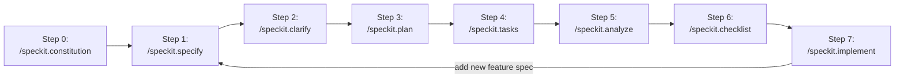

# `AGENTS.md` AI Agent Instruction File for the `mdxpad` codebase

> `mdxpad` is a robust, performant, flexible, extensible, modern markup editor powered by `MDX`.

A native macOS application built with Electron 39, React 19, and TypeScript 5.9 in strict mode. Provides a powerful editing experience for Markdown and MDX files with live preview, AI integration, and extensibility.

---

## Project Architecture

### Process Model
MDXPad follows Electron's multi-process architecture with strict separation:

```
┌─────────────────────────────────────────────────────────┐
│ Main Process (src/main/)                                │
│ - Application lifecycle                                 │
│ - File system operations (file-service.ts)              │
│ - Native OS integration (menu.ts, window.ts)            │
│ - IPC handlers (ipc/)                                   │
│ - Services: AI, templates, autosave, recovery,          │
│   export, git, search, collab, plugins, history          │
└─────────────────────────────────────────────────────────┘
                        │
                        │ IPC (Zod validated)
                        ▼
┌─────────────────────────────────────────────────────────┐
│ Preload Script (src/preload/)                          │
│ - Context bridge (contextIsolation enabled)            │
│ - Type-safe API exposure via window.mdxpad              │
│ - Request/response validation                           │
└─────────────────────────────────────────────────────────┘
                        │
                        ▼
┌─────────────────────────────────────────────────────────┐
│ Renderer Process (src/renderer/)                        │
│ - React 19 application (App.tsx)                        │
│ - CodeMirror 6 editor (components/editor/)              │
│ - MDX preview with worker compilation                   │
│ - Zustand + Immer stores (stores/)                      │
│ - UI components (Radix + Tailwind)                      │
└─────────────────────────────────────────────────────────┘
                        │
                        ▼
┌─────────────────────────────────────────────────────────┐
│ Shared (src/shared/)                                    │
│ - Type definitions (types/)                             │
│ - IPC contracts with Zod schemas (contracts/)           │
│ - Utilities (lib/atomic-write, checksum)                │
│ - Constants and AI config (ai/)                         │
└─────────────────────────────────────────────────────────┘
```

### Directory Structure
```
mdxpad/
├── src/
│   ├── main/              # Main process (Node.js)
│   │   ├── index.ts       # Entry point, app lifecycle
│   │   ├── window.ts      # Window management
│   │   ├── menu.ts        # Native menus
│   │   ├── ipc/           # IPC handlers
│   │   │   ├── file-handlers.ts
│   │   │   ├── ai-handlers.ts, ai-generation-handlers.ts
│   │   │   ├── ai-provider-handlers.ts, ai-session-handlers.ts, ai-usage-handlers.ts
│   │   │   ├── autosave-handlers.ts, template-handlers.ts, window-handlers.ts
│   │   │   ├── collab-handlers.ts    # Wave 3: collaboration
│   │   │   ├── export-handlers.ts    # Wave 1: export orchestration
│   │   │   ├── history-handlers.ts   # Wave 3: version history
│   │   │   ├── link-handlers.ts      # Workspace link graph
│   │   │   ├── notification-handlers.ts  # Wave 3: notifications
│   │   │   ├── platform-handlers.ts  # Cloud sync, collab, extensions, publish
│   │   │   ├── share-handlers.ts     # Wave 3: share links
│   │   │   ├── workspace-handlers.ts # Workspace model
│   │   │   └── ipc-sender-authorization.ts  # Sender validation
│   │   └── services/      # Business logic
│   │       ├── file-service.ts, file-watcher.ts, recent-files.ts
│   │       ├── autosave-service.ts, recovery-service.ts, template-service.ts
│   │       ├── workspace-service.ts, file-index-service.ts
│   │       ├── export-service.ts, export-orchestrator.ts, llms-generator.ts
│   │       ├── collaboration-service.ts, collab-server.ts, collab-awareness.ts
│   │       ├── share-link-service.ts, static-site-generator.ts
│   │       ├── version-history-service.ts, notification-service.ts
│   │       ├── cloud-sync-service.ts, extension-platform-service.ts
│   │       ├── template-marketplace-service.ts, publish-provenance-service.ts
│   │       ├── cli-service.ts, cli-engine.ts, zip-utils.ts
│   │       ├── ai/        # AI provider abstraction
│   │       │   ├── ai-service.ts, agent-service.ts
│   │       │   ├── provider-service.ts, provider-session-service.ts
│   │       │   ├── capability-service.ts, capability-detection.ts
│   │       │   ├── credential-service.ts, usage-service.ts
│   │       │   ├── embedding-service.ts, embedding.ts, vector-store.ts
│   │       │   ├── text-generation.ts, image.ts
│   │       │   ├── ai-session-storage-service.ts, onboarding-service.ts
│   │       │   ├── semantic-search-handlers.ts
│   │       │   ├── instruction-loader-service.ts, prompt-file-loader-service.ts
│   │       │   └── registries/  # Provider model registries
│   │       ├── citation/  # Wave 1: citation management
│   │       │   ├── citation-service.ts, citation-formatter.ts, citation-handlers.ts
│   │       ├── export-formats/  # Wave 1: multi-format export
│   │       │   ├── pdf-exporter.ts, docx-exporter.ts, epub-exporter.ts
│   │       │   ├── latex-exporter.ts, pandoc-bridge.ts, pandoc-detector.ts
│   │       ├── git/       # Wave 1: git integration
│   │       │   ├── git-service.ts, git-handlers.ts
│   │       ├── import/    # Wave 1: document import
│   │       │   ├── notion-importer.ts, google-docs-importer.ts
│   │       │   ├── html-to-mdx-converter.ts, import-handlers.ts
│   │       ├── plugin/    # Wave 2: plugin system
│   │       │   ├── plugin-registry.ts, plugin-loader.ts
│   │       │   ├── plugin-manifest.ts, plugin-handlers.ts
│   │       ├── search/    # Wave 1: full-text search
│   │       │   ├── search-service.ts, search-handlers.ts
│   │       └── template/  # Template management (modularized)
│   │           ├── loader.ts, parser.ts, paths.ts, errors.ts, handlers.ts
│   ├── preload/           # Context bridge
│   │   ├── index.ts       # API composition → window.mdxpad
│   │   ├── api.ts         # MdxpadAPI type definition
│   │   ├── file-api.ts, recovery-api.ts, template-api.ts, event-api.ts
│   │   ├── ai-api.ts, ai-session-api.ts
│   │   ├── workspace-api.ts, export-api.ts, platform-api.ts
│   │   ├── git-api.ts, search-api.ts, import-api.ts, citation-api.ts
│   │   ├── collab-api.ts, share-api.ts, history-api.ts
│   │   ├── plugin-api.ts, notification-api.ts, semantic-search-api.ts
│   │   └── validated-invoke.ts  # Zod-validated IPC helper
│   ├── renderer/          # React application
│   │   ├── App.tsx        # Root component
│   │   ├── main.tsx       # React entry
│   │   ├── components/    # UI components
│   │   │   ├── editor/    # CodeMirror + WYSIWYG editors
│   │   │   │   ├── MDXEditor.tsx, WysiwygEditor.tsx, WysiwygToolbar.tsx
│   │   │   │   ├── EditorModeToggle.tsx, WorkspaceEditorStatus.tsx
│   │   │   ├── preview/   # MDX preview
│   │   │   ├── outline/   # Document outline
│   │   │   ├── CommandPalette/
│   │   │   ├── template-browser/, template-marketplace/
│   │   │   ├── frontmatter/
│   │   │   ├── ai/        # AI chat, multi-file edit
│   │   │   ├── breadcrumb/ # Wave 1: breadcrumb navigation
│   │   │   ├── collaboration/ # Wave 3: collab status, cursors
│   │   │   ├── comments/  # Wave 3: comment threads
│   │   │   ├── export/    # Wave 1: export panel, presets
│   │   │   ├── history/   # Wave 3: version timeline, diff
│   │   │   ├── publish/   # Wave 3: static site publishing
│   │   │   ├── share/     # Wave 3: share dialog
│   │   │   ├── shortcuts/ # Wave 3: keyboard shortcut editor
│   │   │   ├── shell/     # App shell, status bar
│   │   │   │   └── StatusBar/  # Word count, reading time, cursor
│   │   │   ├── tabs/      # Wave 1: editor tabs
│   │   │   ├── tags/      # Wave 3: tag management
│   │   │   ├── voice/     # Wave 3: voice input
│   │   │   ├── workspace/ # Workspace management
│   │   │   └── ui/        # Shared Radix UI primitives
│   │   ├── features/      # Feature modules
│   │   │   ├── ai-agent/  # Wave 2: AI agent mode
│   │   │   ├── ai-provider/ # AI provider settings
│   │   │   ├── code-execution/ # Wave 2: inline code execution
│   │   │   ├── diagrams/  # Wave 2: diagram generation
│   │   │   ├── playground/ # Wave 2: component playground
│   │   │   ├── plugins/   # Wave 2: plugin system UI
│   │   │   └── semantic-search/ # Wave 2: semantic search
│   │   ├── stores/        # Zustand state (25+ stores)
│   │   │   ├── document-store.ts, preview-store.ts, template-store.ts
│   │   │   ├── frontmatter-store.ts, autosave-store.ts, settings-store.ts
│   │   │   ├── tab-store.ts, tag-store.ts, keybinding-store.ts
│   │   │   ├── collab-store.ts, comments-store.ts, version-history-store.ts
│   │   │   ├── multi-file-ai-store.ts, marketplace-store.ts
│   │   │   ├── editor-mode-store.ts, editor-preferences-store.ts
│   │   │   ├── ai-session-store.ts, accessibility-store.ts
│   │   │   ├── export-store.ts, feature-flags-store.ts
│   │   │   ├── workspace-store.ts, command-registry-store.ts
│   │   │   ├── outline-store.ts, ui-layout-store.ts, sync-store.ts
│   │   │   └── file-explorer-store.ts
│   │   ├── hooks/         # React hooks
│   │   │   ├── useCodeMirror/  # CM setup, extensions, themes
│   │   │   ├── useVoiceInput.ts, useKeyboardShortcuts.ts
│   │   │   ├── useAccessibility.ts, useBreadcrumb.ts, useTextStats.ts
│   │   │   └── ... (autosave, recovery, filtering, outline, scroll sync)
│   │   ├── lib/           # Utilities
│   │   │   ├── editor/    # Editor library code
│   │   │   │   ├── extensions/  # 14 CM extensions (see docs/features/editor-extensions.md)
│   │   │   │   ├── keymaps/     # Vim, Emacs keymaps
│   │   │   │   ├── prosemirror-mdx-*.ts  # WYSIWYG schema/parser/serializer
│   │   │   │   ├── yjs-binding.ts  # Yjs-CodeMirror bridge
│   │   │   │   └── comment-decorations.ts, state-bridge.ts, etc.
│   │   │   ├── mdx/       # MDX compilation
│   │   │   │   ├── compiler.ts, compile.ts, worker-pool.ts, request-queue.ts
│   │   │   │   ├── plugin-pipeline.ts, math-plugins.ts
│   │   │   │   └── outline-extractor.ts, fallback-outline-parser.ts
│   │   │   └── frontmatter/, fuzzy-match/, sync/, telemetry/
│   │   ├── commands/      # Command palette commands
│   │   ├── preview-frame/ # Preview iframe content
│   │   └── workers/       # Web workers
│   └── shared/            # Cross-process code
│       ├── types/         # TypeScript definitions
│       ├── contracts/     # IPC schemas (Zod)
│       │   ├── file-schemas.ts, autosave-schemas.ts, template-schemas.ts
│       │   ├── ai-schemas.ts, agent-schemas.ts, workspace-schemas.ts
│       │   ├── export-schemas.ts, export-format-schemas.ts
│       │   ├── git-schemas.ts, search-schemas.ts, import-schemas.ts
│       │   ├── citation-schemas.ts, collab-schemas.ts, share-schemas.ts
│       │   ├── plugin-schemas.ts, history-schemas.ts, notification-schemas.ts
│       │   ├── platform-schemas.ts, semantic-search-schemas.ts
│       │   └── autosave-ipc.ts
│       ├── lib/           # Shared utilities
│       │   ├── atomic-write.ts, checksum.ts, error-utils.ts
│       │   ├── events.ts, ipc.ts, metadata.ts, result.ts, utils.ts
│       ├── security/      # Security utilities
│       │   ├── origin-validator.ts, rate-limiter.ts, sanitizer.ts
│       │   ├── csp-nonce.ts, message-validator.ts, integrity.ts
│       └── ai/            # AI-related shared code
├── tests/                 # Test files
│   ├── unit/, integration/, e2e/
├── scripts/               # Build and utility scripts
├── .github/workflows/     # CI/CD
└── docs/                  # Documentation
    ├── constitution/      # Architectural principles
    ├── specs/             # SDD specifications
    ├── adr/               # Architecture Decision Records
    └── features/          # Feature documentation
```

### Key Patterns

#### IPC Communication
All IPC uses Zod-validated request/response schemas from `src/shared/contracts/`:

```typescript
// src/shared/contracts/file-schemas.ts
import { z } from 'zod';

export const ReadFileRequestSchema = z.object({
  filePath: z.string(),
});

export const ReadFileResponseSchema = z.object({
  content: z.string(),
  // ...
});

// src/main/ipc/file-handlers.ts
ipcMain.handle('file:read', async (_, request) => {
  const validated = ReadFileRequestSchema.parse(request);
  // ...
  return ReadFileResponseSchema.parse(result);
});

// src/preload/index.ts
readFile: (filePath: string) =>
  validatedInvoke('file:read', { filePath }, ReadFileResponseSchema)
```

#### State Management
Zustand with Immer for immutable updates:

```typescript
// src/renderer/stores/document-store.ts
import { create } from 'zustand';
import { immer } from 'zustand/middleware/immer';

interface DocumentState {
  content: string;
  isDirty: boolean;
  setContent: (content: string) => void;
}

export const useDocumentStore = create<DocumentState>()(
  immer((set) => ({
    content: '',
    isDirty: false,
    setContent: (content) =>
      set((state) => {
        state.content = content;
        state.isDirty = true;
      }),
  }))
);
```

#### MDX Compilation
Worker pool pattern for non-blocking compilation:

```typescript
// src/renderer/lib/mdx/compiler.ts
// - Manages pool of Web Workers
// - Request queue with priority
// - Heartbeat monitoring
// - Telemetry for performance tracking
```

#### File Operations
Atomic writes with checksums for data integrity:

```typescript
// src/shared/lib/atomic-write.ts
// - Write to temporary file
// - Compute checksum
// - Atomic rename
// - Cleanup on error
```

#### Error Handling
Custom error classes with context:

```typescript
// src/shared/types/errors.ts
export class FileReadError extends Error {
  constructor(message: string, options?: ErrorOptions) {
    super(message, options);
    this.name = 'FileReadError';
  }
}
```

### Testing Conventions

- **Unit Tests**: Colocate in `__tests__/` directories or `*.test.ts` files
- **Test Naming**: Describe behavior, not implementation
- **AAA Pattern**: Arrange-Act-Assert
- **Coverage Target**: 80%+ overall, 90%+ for critical paths
- **Stores**: Test state transitions and side effects
- **Hooks**: Use `@testing-library/react` `renderHook` and `act`
- **E2E**: Playwright for critical user flows

Example:
```typescript
// src/renderer/stores/__tests__/document-store.test.ts
import { describe, it, expect, beforeEach } from 'vitest';
import { renderHook, act } from '@testing-library/react';
import { useDocumentStore } from '../document-store';

describe('useDocumentStore', () => {
  beforeEach(() => {
    useDocumentStore.getState().reset();
  });

  it('should mark document as dirty when content changes', () => {
    const { result } = renderHook(() => useDocumentStore());

    act(() => {
      result.current.setContent('new content');
    });

    expect(result.current.isDirty).toBe(true);
  });
});
```

### File Organization Rules

- **Max File Size**: 400 lines (enforced via ESLint)
- **Single Responsibility**: One clear purpose per file
- **Barrel Exports**: Use `index.ts` for module exports
- **Naming**:
  - Files: `kebab-case.ts` (e.g., `file-service.ts`)
  - Components: `PascalCase.tsx` (e.g., `EditorPanel.tsx`)
  - Tests: `*.test.ts` or `*.test.tsx`

### Code Quality Standards

- **TypeScript**: Strict mode, no `any`, minimal type casts
- **Linting**: ESLint 9 with typescript-eslint 8, zero errors
- **Formatting**: Prettier 3.4
- **Test Coverage**: 80%+ overall
- **Type Safety**: Avoid `as unknown as`, use type guards
- **Error Handling**: Zod validation for all IPC boundaries

---

## Your Tools
NOTE: this is not an exhaustive list of your tools. make sure to always check for relevant tools as needed/appropriate/useful.

### Search Tools
NOTE: all of these tools are available to you as [MCP (model context protocol)](https://modelcontextprotocol.io/) servers/tools
- [`Tavily Search`](https://docs.tavily.com/documentation/mcp): smart AI context gathering search tool service
- [`Brave Search`](https://github.com/brave/brave-search-mcp-server): easy web search
- `fetch_urls` (from [`fetcher`](https://github.com/jae-jae/fetcher-mcp): robust multi-URL fetcher
- `fetch_html`, `fetch_json`, `fetch_txt`, `fetch_markdown` (from [`fetch`](https://github.com/zcaceres/fetch-mcp)): targeted content fetchers
- [`context7`](https://github.com/upstash/context7):  pulls up-to-date, version-specific documentation and code examples straight from the source — and places them directly into your prompt.
- [`deepwiki`](https://docs.devin.ai/work-with-devin/deepwiki-mcp): provides programmatic access to DeepWiki’s public repository documentation and search capabilities
- [`repomix`](https://repomix.com/guide/mcp-server): provides tools that enable AI assistants to package local or remote repositories for analysis without requiring manual file preparation.

### Thinking/Reasoning Methods
NOTE: THESE MCP SERVERS/TOOLS CAN BE USED INDIVIDUALLY OR COMBINED/ENSEMBLED AS NEEDED/APPROPRIATE/USEFUL TO MOST EFFECTIVELY SOLVE A GIVEN PROBLEM/REQUEST.
- [`sequential-thinking`](https://github.com/modelcontextprotocol/servers/tree/main/src/sequentialthinking): provides a tool for dynamic and reflective problem-solving through a structured thinking process
- [`atom-of-thoughts`](https://github.com/kbsooo/MCP_Atom_of_Thoughts): a decomposition-based reasoning framework.
- [`shannon-thinking`](https://github.com/olaservo/shannon-thinking): helps break down complex problems into structured thoughts following Shannon's approach of problem definition, mathematical modeling, and practical implementation.
- [`structured-thinking`](https://github.com/Promptly-Technologies-LLC/mcp-structured-thinking): motivation for this project is to allow LLMs to programmatically construct mind maps to explore an idea space, with enforced "metacognitive" self-reflection.
- [`crash`](https://github.com/nikkoxgonzales/crash-mcp): structured, iterative reasoning. CRASH helps AI assistants break down complex problems into trackable steps with confidence tracking, revision support, and branching for exploring alternatives.
- [`deep-lucid-3d`](https://github.com/MushroomFleet/DeepLucid3D-MCP): an implementation of the Unified Cognitive Processing Framework as an MCP server. It combines recursive self-awareness with dimensional knowledge categorization to provide a powerful approach to problem-solving and creative thinking.
- [`cascade-thinking`](https://github.com/drewdotpro/cascade-thinking-mcp): Transform linear problem-solving into rich, multi-dimensional exploration with true branching and intelligent thought management.): Transform linear problem-solving into rich, multi-dimensional exploration with true branching and intelligent thought management.
- [`lotus-wisdom`](https://github.com/linxule/lotus-wisdom-mcp):  provides a tool for problem-solving using the Lotus Sutra's wisdom framework, combining analytical thinking with intuitive wisdom.
- [`think-strategies`](https://github.com/aaronsb/think-strategies): provides a tool for dynamic and reflective problem-solving through structured thinking processes.
- [`creative-thinking`](https://github.com/uddhav/creative-thinking): implements 28 creative thinking techniques through a unified framework combining generative creativity with systematic risk assessment, analytical verification, and post-action reflexivity tracking.

---

## Codebase Development Methodology & Framework
- [`Spec-Driven Development` (**`SDD`**)](https://github.com/github/spec-kit/blob/main/spec-driven.md) is the primary development methodology/framework for this codebase.
- [`GitHub Spec Kit`](https://github.com/github/spec-kit/blob/main/README.md) (e.g. *`specify`* *cli*) orchestrates + manages **`SDD`** flows for all non-trivial features/enhancements/bug fixes.

### `spec-kit` dev flow

an AI dev agent uses [e.g. for ***Claude Code***: `.claude/commands/` `spec-kit` commands (e.g. `specify`, `clarify`, `plan`, `tasks`, `analyze`, `checklist`, `implement` etc)] to orchestrate + manage the dev flow for non-trivial features/enhancements/bug fixes in a new branch as per **`SDD`** methodology/framework:



In ***Claude Code***, batches of parallel, intelligently well-defined *subagents* are used to efficiently + robustly implement all of the tasks in the tasks list for each non-trivial feature/enhancement/bug fix. Flows of which are independent from each other enough are developed in parallel by separate claude code instances (each with its own iterative batches of parallel subagents) on different git worktrees/branches, and then merged together later.

---

## Your Rules
YOU MUST FOLLOW ALL OF THE RULES BELOW (7/7 total rules) AT ALL TIMES!!!
- use latest versions: always use the latest stable versions of any and all dependencies/libraries/packages/frameworks. use your `package version` and `context7` MCPs (and any others as useful) for help
- batch operations: always batch your tool calls (operations) where possible: MCP tools (e.g., `fetch_urls` [from the `fetcher` MCP] over repeated `fetch_url`), shell commands via brace expansion (`mkdir dir/{a,b,c}`), and similar parallelizable patterns.
- reuse existing logic: always check for existing logic/code snippets/utilities/libraries/packages that can be reused/extended to satisfy a request before creating new logic/code from scratch.
- web research first when uncertain: whenever uncertainty arises start by conducting deep, targeted web research to gather the latest information from authoritative sources using your MCP web tools (e.g Brave Search, Tavily Search, etc). if this additional web research does not elucidate the uncertainty, then succinctly interview the user to clarify the uncertainty before proceeding.
- maintain freshest info: whenever up-to-date information is useful/helpful/required, always use your MCP web tools (e.g Brave Search, Tavily Search, etc) to gather the latest information from authoritative sources.
- robustly use your subagents intelligently: always intelligently apply your subagents robustly whenever possible/appropriate/useful (in parallel within iterative batches).
- for any and all non-trivial requests, intelligently evaluate the available MCP tool thinking/reasoning methods and choose the best one(s) to use for the given request, then apply them appropriately.

---

## Active Technologies

### Core Stack
- **Runtime**: Electron 39.2.7 (macOS native)
- **Language**: TypeScript 5.9.x with strict mode
- **Framework**: React 19 with React DOM
- **Build**: electron-vite 3.x + Vite 6.x
- **Package Manager**: pnpm 10.11.1

### Editor & Preview
- **Editor**: CodeMirror 6.x with language support
- **WYSIWYG**: ProseMirror (prosemirror-state, prosemirror-view, prosemirror-markdown)
- **MDX**: @mdx-js/mdx 3.x + @mdx-js/react 3.x
- **Markdown**: remark-gfm 4.x, remark-frontmatter 5.x, remark-math 6.x
- **Syntax Highlighting**: rehype-highlight 7.x
- **Math**: KaTeX 0.16.x (rehype-katex 7.x, remark-math 6.x)
- **Diagrams**: mermaid 11.x

### State & UI
- **State**: Zustand 5.x with Immer 11.x (25+ stores)
- **UI Components**: Radix UI primitives
- **Styling**: Tailwind CSS 4.x
- **Icons**: Lucide React
- **Panels**: react-resizable-panels 4.1.0
- **Drag & Drop**: @dnd-kit/core 6.x, @dnd-kit/sortable 10.x

### AI & Services
- **AI SDK**: Vercel AI SDK v6 (@ai-sdk/anthropic, @ai-sdk/openai, ollama-ai-provider)
- **Search**: fzf 0.5.2, minisearch 7.x (full-text), vector-store (semantic)
- **Collaboration**: yjs 13.x, y-websocket 3.x, y-indexeddb 9.x
- **Export**: docx 9.x, epub-gen-memory 1.x
- **Git**: simple-git 3.x
- **Citations**: @citation-js/core 0.7.x
- **Diff**: diff 8.x
- **File Watching**: chokidar 5.0.0
- **Validation**: zod 3.24.x
- **YAML**: yaml 2.8.x, gray-matter 4.0.x
- **Storage**: electron-store 11.0.2

### Development & Testing
- **Testing**: Vitest 2.x + @testing-library/react 16.x
- **E2E**: Playwright 1.49.x
- **Coverage**: @vitest/coverage-v8 2.x
- **Linting**: ESLint 9.x with typescript-eslint 8.x
- **Formatting**: Prettier 3.4.x

## Recent Changes

### 2026-02-27: Wave 3 — Collaboration, Publishing & Polish
- **Collaboration**: Yjs WebSocket server, collab-store, cursor overlay, comment threads, suggestions
- **Share Links**: Token-based share link service with expiration and access modes
- **Static Site Publishing**: MDX-to-HTML static site generator with index page and CSS
- **Version History**: Aggregated history from autosave snapshots and git commits
- **Tags/Taxonomy**: Hierarchical tag store with file assignment and tree view
- **Keyboard Shortcut Editor**: Customizable keybindings with conflict detection
- **WYSIWYG Editor**: ProseMirror-based editor with MDX schema, toolbar, mode toggle
- **Multi-File AI Editing**: Per-file accept/reject workflow for AI-driven edits
- **Template Marketplace**: Browse and install document templates
- **Accessibility**: High contrast theme, focus traps, accessibility store
- **Voice Input**: Web Speech API integration for voice-to-text
- **Notifications**: Native system notification service with queue management

### 2026-02-25: Wave 2 — Intelligence & Extensibility
- **AI Agent Mode**: Tool-using agent with plan steps, approval workflow, streaming
- **Semantic Search**: Embedding-based workspace search with vector store
- **Next-Edit Prediction**: AI ghost text completions in CodeMirror
- **Diagrams**: AI-powered diagram generation (Mermaid)
- **Plugin System**: Registry, loader, manifest validation, theme manager
- **Slash Commands**: `/command` autocomplete in editor
- **Code Execution**: Sandboxed inline JS/TS execution with output widgets
- **Component Playground**: Interactive component preview and experimentation
- **Go-to-Definition**: Navigate to component/import definitions

### 2026-02-20: Wave 1 — Editor Extensions, Export & Backend Services
- **CM Extensions**: Multi-cursor, code folding, regex find/replace, snippets, minimap, focus mode, distraction-free, spellcheck, font settings, word wrap
- **Keymaps**: Vim and Emacs keymap modes
- **Export Formats**: PDF, DOCX, EPUB, LaTeX, Pandoc bridge with detection
- **Git Integration**: Git service with simple-git, status, diff, commit
- **Full-Text Search**: MiniSearch-based workspace search
- **Document Import**: Notion, Google Docs, HTML-to-MDX converters
- **Citations**: BibTeX parsing, CSL formatting via citation-js
- **Editor Tabs**: Multi-tab editing with tab store and context menus
- **Breadcrumb Navigation**: File path breadcrumb component
- **Math Support**: KaTeX rendering via remark-math + rehype-katex
- **Word Count/Reading Time**: Text statistics in status bar
- **Export Orchestration**: Job lifecycle, presets, CLI orchestration, llms.txt generation
- **Workspace Model**: Projects, link graph, metadata collections, file indexing
- **Feature Flags**: Runtime feature surface toggles

### 2026-02-16: Full Codebase Audit
- Split 5 monolithic files into focused modules (<400 lines each)
- Reduced ESLint errors from 528 to 0, type casts from 65 to <10
- Added 106+ new tests (2610+ total passing, 80%+ coverage)
- Fixed security, concurrency, and error handling defects

### Foundation (pre-Wave)
- 028: BYOK AI provider abstraction with Vercel AI SDK
- 020: Visual frontmatter editor with schema validation
- 016: Template library with custom and built-in templates
- 014: FZF-based fuzzy search
- 007-000: Application shell, command palette, file system, live preview, IPC contracts, TypeScript strict foundation
